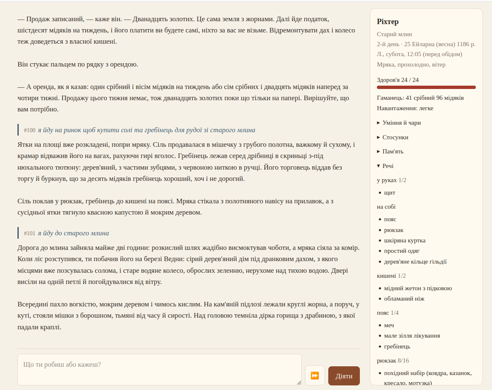
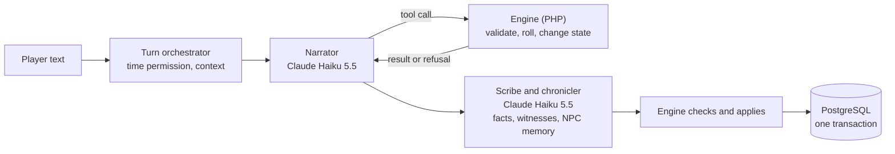

# Eldvir

**A single-player, text-based fantasy RPG where an LLM narrates and a deterministic engine rules.**
I designed it and built it in about two and a half weeks by directing AI tools: [Claude Code](https://claude.com/claude-code)
wrote the code, a second model (OpenAI Codex) reviewed it, and inside the game Claude Haiku narrates while
the engine does every calculation. I owned the design, the decisions and the verification.

This repository is a showcase. It holds no source code. It explains how the game uses an LLM and how I work with
AI agents, with examples you can trace to real commits.



*Game 13, turns 100–101 (the UI is in Ukrainian during development). Left: the narrator's text. Right: what the
engine holds: date, weather, health, purse, every item in its slot. The prices in the text (twelve gold for the land,
sixty copper a week in tax) come from the engine's `holding` tool, not from the model. One slip is visible too: the
engine quoted rent as 1 silver 80 copper a week, the narrator wrote "one silver and eight copper". If the player rents,
the engine charges its own price, so the slip stays in the prose. The ⏩ button gives consent to skip time.
Turn 101 is where [case study 2](docs/case-studies.md#2-from-a-playtest-bug-to-a-subsystem) begins.*

## At a glance

| | |
|---|---|
| **Time** | 16 working days, 15 Oct – 2 Nov 2026; 834 prompts from me; [how this was measured](docs/ai-workflow.md#8-time-and-numbers) |
| **Stack** | PHP 8.5, Symfony 8, PostgreSQL 16, FrankenPHP in Docker; Claude API (narrator and fact extractor) |
| **Size** | ~55,000 lines of PHP in the game, ~27,500 lines of tests, 383 commits |
| **Tests** | 1,176 automated tests, plus paid evaluation runs of the narrator on recorded turns |
| **Cost per turn** | ≈ $0.005 on Claude Haiku 5.5 with all three model calls; was ≈ $0.06 on Sonnet 5.5 + Haiku 4.5. Whole project: $35.27 of API, [split](docs/llm-design.md#7-what-it-cost) |
| **Status** | Playable in the browser, played by me; not released. Working language with the agents is Ukrainian, the release will be English |

## Two layers of AI work

**1. AI inside the product** — [docs/llm-design.md](docs/llm-design.md)

- **The engine decides, the model describes.** Dice, prices, loot, damage, law and time live in PHP. The narrator
  can only ask for them through 18 tools, and the engine can refuse.
- **The model can't leak what it never sees.** Names the player hasn't heard are replaced before the prompt is
  built; world secrets never enter the request.
- **Every token in a turn is measured.** Each change that grows the prompt is reported with its token count and
  price per turn.
- **Models are chosen by evaluation runs, not by reputation.** Recorded turns are replayed on several models with real
  tools; I rate the prose blind. The narrator, the scribe and the NPC chronicler each got their own test, and the switch
  to Haiku 5.5 cut the cost of a turn about 12×.

**2. How I work with AI agents** — [docs/ai-workflow.md](docs/ai-workflow.md)

- **The agent proposes, I decide.** Every package of work starts as a written plan with options and trade-offs; nothing
  is built until I pick.
- **Context lives in files.** Rules, design, backlog, "ready to build" plans and "what to test next" are versioned
  documents the agent must update in the same commit as the code.
- **A second model reviews the first one.** After each large package Codex audits the commits on a frozen snapshot and
  writes failing tests for what it finds; Claude checks each finding against the code; I decide what gets fixed.
- **No automatic multi-agent orchestration — on purpose.** [Why](docs/ai-workflow.md#6-why-i-dont-use-agent-orchestration).
- **Guardrails** on secrets, spoilers and every paid API run.

Worked examples: [docs/case-studies.md](docs/case-studies.md).
How Claude assesses our collaboration, including what went wrong: [docs/retrospective.md](docs/retrospective.md).

## How a turn works



## What's in this repository

```
docs/llm-design.md              how the game uses the LLM: boundaries, tools, context, model choice, cost
docs/ai-workflow.md             how I work with Claude Code and Codex
docs/case-studies.md            four examples traced to commits
docs/retrospective.md           the agent's assessment of our work
context/CLAUDE.md               the project's root context file, translated
context/agent-memory.md         the agent's memory rules about how to work, with reasons
context/narrator-excerpt.md     four sections of the narrator's system prompt
context/design-docs-excerpt.md  one feature through the backlog, the plan and the evaluation-run list
images/turn.png                 a game turn
```

The full code can be shown on a call.

## License

All rights reserved. Shared for evaluation purposes only, see [LICENSE](LICENSE).
